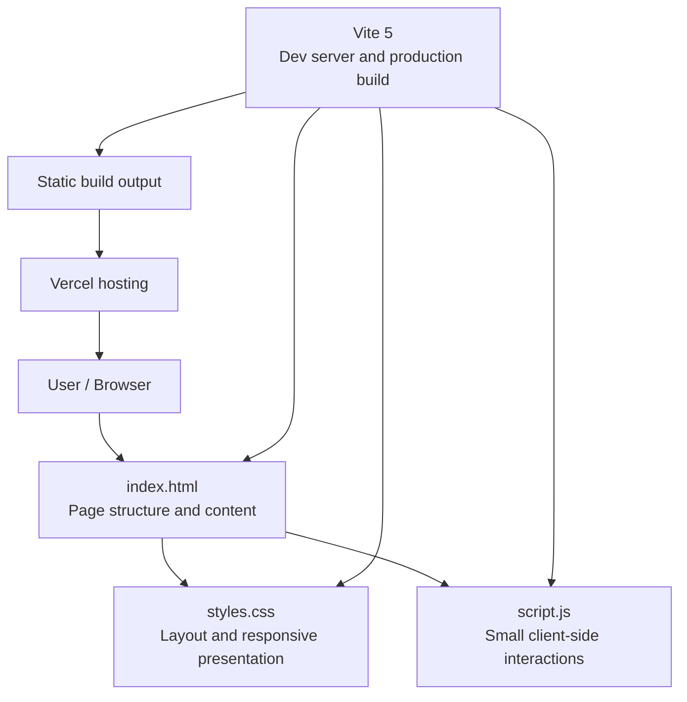
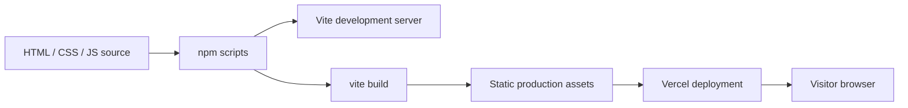
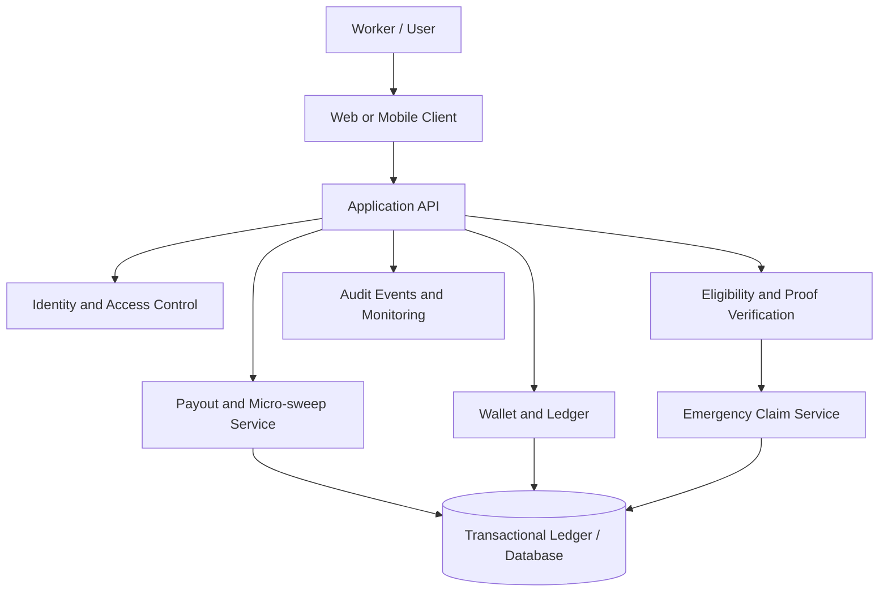

# SlipStream — System Architecture

> This document describes the architecture of the code currently checked into this repository. The checked-in implementation is a static portfolio-style web page, not the full gig-worker insurance simulation described in the product concept. Update this document as the simulation implementation is added.

## 1. Architecture Overview

The current application is a client-rendered static site served by Vite during development and built into static assets for deployment.



## 2. Main Components

| Component | Responsibility |
|---|---|
| `index.html` | Defines the page sections, navigation, profile/hero content, stack and project cards, contact link, and script/style references. |
| `styles.css` | Defines design tokens, typography, colors, layout, card styles, hover states, and responsive breakpoints. |
| `script.js` | Runs after DOM content loads; animates elements marked with `data-count` and sets the footer year dynamically. |
| `package.json` | Defines Vite development, build, and preview scripts. |
| Vite | Serves the site locally and produces static production assets. |
| Vercel | Hosts the deployed site (assuming the deployment is configured to build this repository). |

## 3. Runtime Flow

1. A visitor opens the deployed site in a browser.
2. The browser loads `index.html`.
3. The stylesheet `styles.css` applies the layout and responsive visual design.
4. `script.js` runs after the document is parsed.
5. Statistic counters animate toward their configured `data-count` values, and the footer year is populated from the browser's current date.
6. Navigation links move to page sections using in-page anchors. The layout adapts through CSS media queries.

## 4. Build and Deployment Flow



Commands:

```bash
npm install
npm run dev
npm run build
npm run preview
```

The exact Vercel project settings and deployment configuration are not stored in the current repository files reviewed here, so the deployment path above represents the expected static-site workflow rather than a verified Vercel configuration.

## 5. Data and Backend Boundaries

- The checked-in site has no application server or API routes.
- No database, authentication service, or external business API integration is defined in the files reviewed.
- The JavaScript behavior is local to the browser and is limited to the counter animation and footer year.
- The insurance wallet, micro-sweep calculations, insurance battery, proof verification, and emergency claim rules are part of the broader product concept; they are **not implemented by the current checked-in files**.

## 6. Intended Product Architecture (Future Design — Not Yet Implemented Here)

The following is a conceptual direction for a future gig-worker protection platform, not a description of the current repository implementation.



A production implementation would need secure authentication, server-side validation, an auditable ledger, idempotent transaction processing, authorization checks, privacy controls, monitoring, and appropriate financial/insurance compliance review. No such backend components should be considered present until their source code and deployment are added to this repository.

## 7. Current Stack

- **HTML5** — structure
- **CSS3** — styling and responsive layout
- **Vanilla JavaScript** — browser-side interactions
- **Vite 5** — development and build tooling
- **Vercel** — live hosting, as identified by the project deployment URL

See [README.md](README.md) for setup instructions and the current repository file tree.
